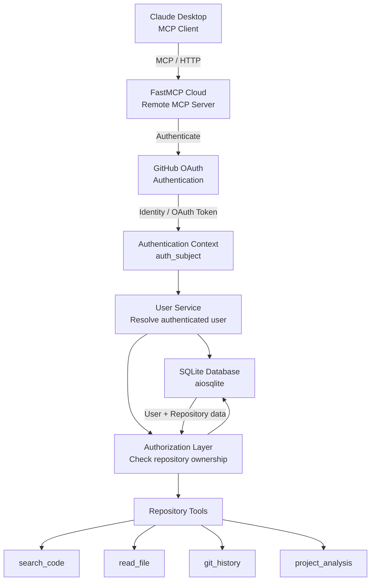
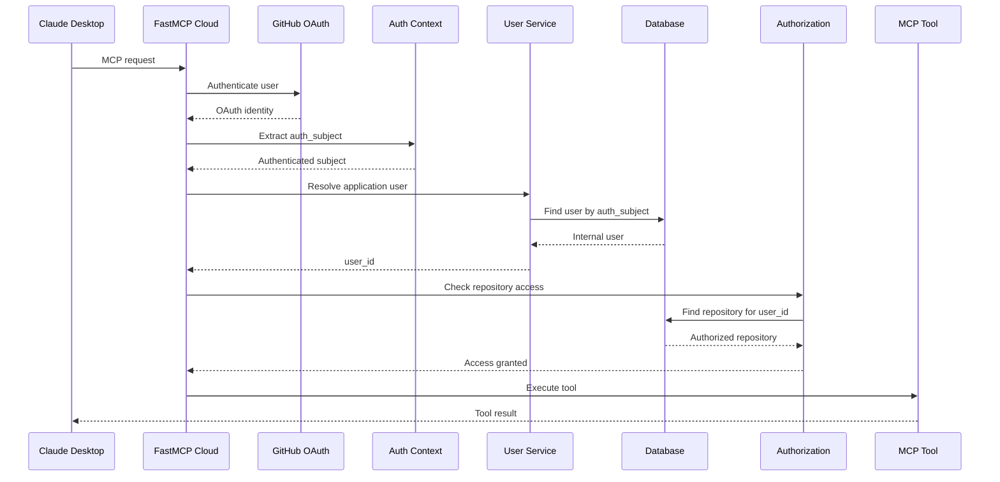

# Project Assistant

A secure, remote **Model Context Protocol (MCP) server** built with **FastMCP v2**, designed to give AI clients controlled access to project repositories.

The server provides tools for searching source code, reading files, inspecting Git history, analyzing projects, and managing user-owned repositories.

Authentication is handled through **GitHub OAuth**, while authorization is enforced at the application/database level so users can only access repositories belonging to them.

The project is designed as a realistic **multi-user remote MCP application**, deployed on **FastMCP Cloud** and intended to be used with MCP clients such as Claude Desktop.

---

## Architecture



### Authentication and Authorization Flow



---

# Key Features

- Remote MCP server using **FastMCP v2**
- HTTP-based MCP transport
- GitHub OAuth authentication
- Multi-user architecture
- User-to-repository ownership model
- Repository-level authorization
- Async SQLite database using **aiosqlite**
- Git repository inspection using **GitPython**
- Source-code search
- File reading
- Git commit history
- Project analysis
- FastMCP Cloud deployment
- Authentication separated from authorization
- Database access separated from business logic
- Designed for future PostgreSQL migration

---

# Technology Stack

| Technology | Purpose |
|---|---|
| Python | Backend language |
| FastMCP v2 | MCP server framework |
| MCP | AI-tool communication protocol |
| GitHub OAuth | Authentication |
| aiosqlite | Asynchronous SQLite database access |
| SQLite | Current database |
| GitPython | Git repository interaction |
| FastMCP Cloud | Remote deployment |
| Claude Desktop | MCP client |
| GitHub | Source control and OAuth provider |

---

# Project Structure

```text
project-assistant/
│
├── server.py
│
├── auth/
│   ├── __init__.py
│   ├── context.py
│   ├── service.py
│   └── authorization.py
│
├── database/
│   ├── __init__.py
│   ├── connection.py
│   ├── schema.py
│   └── repository.py
│
├── data/
│   └── app.db
│
├── .env
├── .gitignore
└── README.md
```

---

# How the Project Works

The application follows a layered architecture.

```text
MCP Client
    │
    ▼
FastMCP Server
    │
    ├── Authentication
    │       │
    │       ▼
    │   auth_subject
    │
    ├── User Service
    │       │
    │       ▼
    │   internal user_id
    │
    ├── Authorization
    │       │
    │       ▼
    │   authorized repository
    │
    └── MCP Tools
            │
            ├── Search code
            ├── Read files
            ├── Git history
            └── Project analysis
```

The important security principle is:

> The AI client can request an operation, but it does not decide which user it belongs to.

The server derives the authenticated identity from the authentication context.

---

# Authentication

Authentication answers:

> **"Who is this user?"**

The project uses GitHub OAuth through FastMCP.

The authentication flow is approximately:

```text
Claude Desktop
      │
      ▼
FastMCP Cloud
      │
      ▼
GitHub OAuth
      │
      ▼
Authenticated identity
      │
      ▼
auth_subject
```

The authentication subject is then used to locate the corresponding application user.

---

# Authorization

Authentication alone is not enough.

After identifying the user, the server checks what that user is allowed to access.

Authorization answers:

> **"What is this user allowed to access?"**

The application uses the following relationship:

```text
GitHub Identity
       │
       ▼
auth_subject
       │
       ▼
users
       │
       ▼
user_id
       │
       ▼
repositories
       │
       ▼
repository ownership
```

A repository query therefore follows the pattern:

```text
authenticated user
        ↓
internal user_id
        ↓
repository_id
        ↓
repository WHERE user_id = authenticated user
```

This prevents one user from accessing another user's repository simply by supplying another repository ID.

---

# Database Design

The current database contains two primary entities:

```text
┌─────────────────────────┐
│          users          │
├─────────────────────────┤
│ id              PK      │
│ auth_subject    UNIQUE  │
│ name                    │
│ email           UNIQUE  │
│ created_at              │
└────────────┬────────────┘
             │
             │ 1
             │
             │ N
┌────────────▼────────────┐
│      repositories
